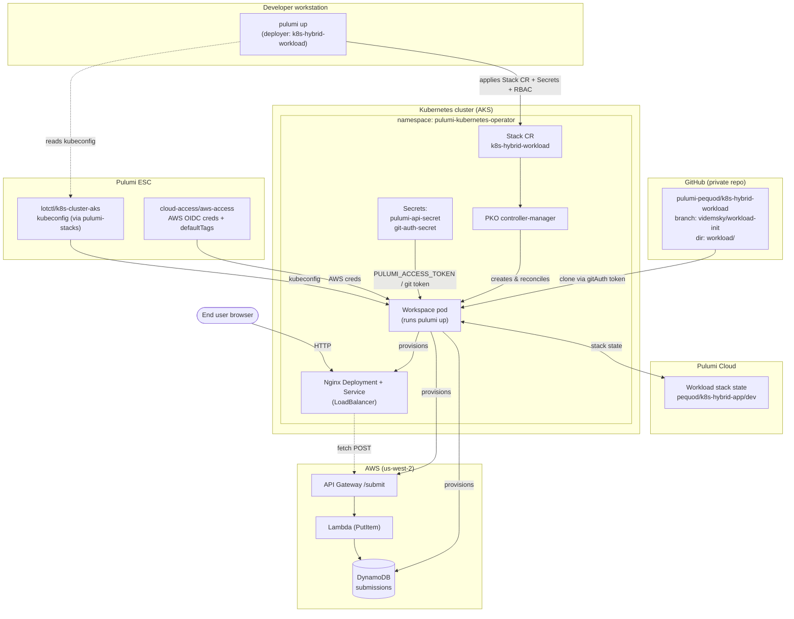

# k8s-hybrid-workload

A hybrid **AWS + Kubernetes** demo driven by the [Pulumi Kubernetes Operator
(PKO) v2](https://www.pulumi.com/product/pulumi-kubernetes-operator/).

This repo contains **two** Pulumi programs:

| Program | Project | Role |
| --- | --- | --- |
| `index.ts` (repo root) | `k8s-hybrid-workload` | **Deployer** — defines a PKO `Stack` custom resource (`pulumi.com/v1:Stack`) plus the Secrets/RBAC it needs, and applies them to a cluster where the operator is already installed. |
| `workload/index.ts` | `k8s-hybrid-app` | **Workload** — the program the operator clones from Git and runs *in-cluster*. Provisions the AWS backend and the Kubernetes frontend. |

The deployer hands the operator a Git URL + ESC environments; the operator
clones the workload, runs `pulumi up` inside the cluster, and continuously
reconciles it (polling for new commits and refreshing drift).

## What the workload provisions

**AWS (serverless backend)**
- **DynamoDB** table storing `{ email (partition key), name, submittedAt }`.
- A **least-privilege IAM role + Lambda** that does `PutItem` on that table only.
- An **API Gateway** REST API (`@pulumi/aws-apigateway`) with explicit CORS,
  routing `POST` / `GET` / `OPTIONS` `/submit` to the Lambda.

**Kubernetes (frontend)**
- A **ConfigMap** holding a Pulumi-branded static site (inlined Pulumipus SVG,
  Bootstrap 5 responsive layout) + Nginx config, with the live API Gateway URL
  substituted in at deploy time.
- An **Nginx Deployment** (3 replicas, readiness/liveness on `/healthz`).
- A **Service** of `type: LoadBalancer` exposing the site publicly.

## What the frontend looks like

The published frontend renders the Pulumipus mascot beside a sign-up form. The
layout is responsive (Bootstrap 5): side-by-side on desktop, stacked on mobile.


---

## Architecture



---

## Prerequisites

- **Node.js 22+** (`nvm use 22`) and **npm**.
- **Pulumi CLI** logged in to Pulumi Cloud (`pulumi login`).
- A **Kubernetes cluster** (this demo targets AKS) with **PKO v2 already
  installed** (namespace `pulumi-kubernetes-operator`, ServiceAccount
  `controller-manager`). See the [PKO install docs](https://www.pulumi.com/docs/iac/using-pulumi/continuous-delivery/pulumi-kubernetes-operator/).
- **AWS account** reachable via the ESC environment's OIDC role.
- A **GitHub token** with read access to this (private) repo.
- A **Pulumi access token** for the operator to read/write the workload stack's state.

---

## Configuration variables

All variables are set on the **deployer** stack (`k8s-hybrid-workload`) via
`pulumi config`. Sensible defaults exist for everything except the two secrets.

### Required secrets

| Config key | How to set | Purpose |
| --- | --- | --- |
| `pulumiAccessToken` | `pulumi config set --secret pulumiAccessToken <token>` | `PULUMI_ACCESS_TOKEN` for the operator workspace (stored as K8s Secret `pulumi-api-secret`). |
| `githubToken` | `pulumi config set --secret githubToken <token>` | Clones the private workload repo (stored as K8s Secret `git-auth-secret`). |

### Optional (have defaults)

| Config key | Default | Purpose |
| --- | --- | --- |
| `workloadOrg` | current org | Org of the managed workload stack. |
| `workloadProject` | `k8s-hybrid-app` | Project of the managed workload stack. |
| `workloadStackName` | `dev` | Stack name of the managed workload stack. |
| `projectRepo` | `https://github.com/pulumi-pequod/k8s-hybrid-workload.git` | Git repo the operator clones. |
| `branch` | `refs/heads/main` | Git ref to track. |
| `repoDir` | `workload` | Sub-directory containing the workload `Pulumi.yaml`. |
| `escEnvironments` | `["cloud-access/aws-access", "lotctl/k8s-cluster-aks"]` | ESC envs attached to the Stack CR. |
| `operatorNamespace` | `pulumi-kubernetes-operator` | Namespace of the operator + Stack CR. |
| `workspaceServiceAccount` | `controller-manager` | SA the workspace pod runs as (carries cloud identity). |
| `reconcileTrigger` | `1` | Bump to force a re-run of a stalled stack. |
| `kubeconfig` | *(from ESC)* | Kubeconfig the deployer's own K8s provider uses; normally supplied by the `lotctl/k8s-cluster-aks` ESC env. |

The **workload** stack (`k8s-hybrid-app`) has one optional config:

| Config key | Default | Purpose |
| --- | --- | --- |
| `appName` | `pulumipus-signup` | Prefix for all AWS + K8s resource names. |

---

## ESC environments

Two ESC environments must exist. Attach them to the deployer stack in
`Pulumi.dev.yaml` (already wired) and to the Stack CR via `escEnvironments`.

### `cloud-access/aws-access` — AWS credentials + default tags

Supplies short-lived AWS credentials via OIDC and a stack-level `Owner`
default tag.

```yaml
# esc env: cloud-access/aws-access
values:
  aws:
    region: us-west-2
    creds:
      fn::open::aws-login:
        oidc:
          duration: 1h
          roleArn: arn:aws:iam::<ACCOUNT_ID>:role/<YOUR_OIDC_DEPLOY_ROLE>
          sessionName: pequod-aws-access
  environmentVariables:
    AWS_ACCESS_KEY_ID: ${aws.creds.accessKeyId}
    AWS_SECRET_ACCESS_KEY: ${aws.creds.secretAccessKey}
    AWS_SESSION_TOKEN: ${aws.creds.sessionToken}
  pulumiConfig:
    aws:region: ${aws.region}
    aws-native:region: ${aws.region}
    aws:defaultTags:
      tags:
        Owner: pequod
```

> **Note on tags:** `aws:defaultTags` applies an `Owner` tag to every AWS
> resource. The workload code deliberately does **not** set a lowercase `owner`
> tag, because AWS IAM rejects tag keys that collide case-insensitively
> (`Owner` vs `owner`).

### `lotctl/k8s-cluster-aks` — kubeconfig for the target cluster

Projects the kubeconfig from the cluster's Pulumi stack output and imports the
Azure login environment the kubeconfig depends on.

```yaml
# esc env: lotctl/k8s-cluster-aks
imports:
  # Needed for the AKS kubeconfig to authenticate.
  - cloud-access/azure-access
values:
  stack-outputs:
    fn::open::pulumi-stacks:
      stacks:
        shared-dev-aks-stack:
          stack: shared-dev-aks/dev
  files:
    KUBECONFIG: ${stack-outputs.shared-dev-aks-stack.kubeconfig}
  pulumiConfig:
    kubeconfig: ${stack-outputs.shared-dev-aks-stack.kubeconfig}
```

> If your cluster is not managed by a Pulumi stack, replace the
> `fn::open::pulumi-stacks` block with a literal/secret kubeconfig, or an
> `fn::open::azure-login` + AKS `get-credentials` flow. The only requirement is
> that both `files.KUBECONFIG` and `pulumiConfig.kubeconfig` resolve to a valid
> kubeconfig for the target cluster.

---

## Deploy

```bash
nvm use 22
npm install

# Select / create the deployer stack.
pulumi stack select dev   # or: pulumi stack init dev

# Set the two required secrets.
pulumi config set --secret pulumiAccessToken <PULUMI_ACCESS_TOKEN>
pulumi config set --secret githubToken       <GITHUB_TOKEN>

# (Optional) point at a different repo/branch/dir or workload stack.
# pulumi config set branch refs/heads/main
# pulumi config set projectRepo https://github.com/<org>/<repo>.git

# Preview, then apply. This creates the Secrets, RBAC, and the Stack CR.
pulumi preview
pulumi up
```

Once applied, the **operator takes over**: it clones `workload/`, runs
`pulumi up` for `k8s-hybrid-app/dev`, and reconciles every 60s.

### Type-check before deploying

```bash
npx tsc --noEmit                 # deployer
( cd workload && npx tsc --noEmit )   # workload
```

---

## Introspecting the cluster (ESC + kubectl)

Run `kubectl` with the cluster credentials sourced from ESC — no local
kubeconfig needed. The pattern is `pulumi env run <env> -- kubectl ...`.

```bash
# Watch the Stack CR reconcile (READY should become True).
pulumi env run lotctl/k8s-cluster-aks -- \
  kubectl get stack k8s-hybrid-workload -n pulumi-kubernetes-operator -o wide

# Full Stack CR status conditions (Ready / Reconciling / Stalled + reason).
pulumi env run lotctl/k8s-cluster-aks -- \
  kubectl get stack k8s-hybrid-workload -n pulumi-kubernetes-operator \
  -o jsonpath='{range .status.conditions[*]}{.type}={.status} ({.reason}){"\n"}{end}'

# The operator controller logs (commit detection, reconcile events).
pulumi env run lotctl/k8s-cluster-aks -- \
  kubectl logs deployment/controller-manager -n pulumi-kubernetes-operator --tail=100

# The workspace pod's pulumi update log (what `pulumi up` is doing in-cluster).
pulumi env run lotctl/k8s-cluster-aks -- \
  kubectl logs k8s-hybrid-workload-workspace-0 -n pulumi-kubernetes-operator \
  -c pulumi --tail=200

# The deployed frontend (Deployment / Service / ConfigMap). NOTE: the workload
# resources land in the operator namespace, not `default`.
pulumi env run lotctl/k8s-cluster-aks -- \
  kubectl get deploy,svc,cm,pods -n pulumi-kubernetes-operator | grep -i pulumipus

# The public LoadBalancer address of the frontend.
pulumi env run lotctl/k8s-cluster-aks -- \
  kubectl get svc pulumipus-signup-web -n pulumi-kubernetes-operator \
  -o jsonpath='{.status.loadBalancer.ingress[0].ip}{"\n"}'
```

---

## Validating records in DynamoDB (ESC + AWS CLI)

Run the AWS CLI with credentials sourced from the AWS ESC environment. First
grab the table name from the workload stack outputs:

```bash
TABLE=$(pulumi stack output dynamoTableName --stack pequod/k8s-hybrid-app/dev)

# Get a specific record by email (partition key).
pulumi env run cloud-access/aws-access -- \
  aws dynamodb get-item --region us-west-2 \
    --table-name "$TABLE" \
    --key '{"email":{"S":"ada@example.com"}}'

# Scan all submissions (small demo table).
pulumi env run cloud-access/aws-access -- \
  aws dynamodb scan --region us-west-2 --table-name "$TABLE"

# Count items.
pulumi env run cloud-access/aws-access -- \
  aws dynamodb scan --region us-west-2 --table-name "$TABLE" --select COUNT

# Confirm the table is ACTIVE.
pulumi env run cloud-access/aws-access -- \
  aws dynamodb describe-table --region us-west-2 --table-name "$TABLE" \
  --query 'Table.TableStatus'
```

### Smoke-test the API directly

```bash
API=$(pulumi stack output apiGatewayEndpoint --stack pequod/k8s-hybrid-app/dev)

# POST a JSON submission (expect HTTP 200 "Submission stored").
curl -i -X POST "$API" -H "Content-Type: application/json" \
  -d '{"name":"Ada Lovelace","email":"ada@example.com"}'

# GET query-string variant.
curl -i "$API?name=Grace+Hopper&email=grace@example.com"

# CORS preflight (expect 204 + Access-Control-* headers).
curl -i -X OPTIONS "$API" \
  -H "Origin: http://example" -H "Access-Control-Request-Method: POST"
```

---

## Workload stack outputs

After the operator reconciles `k8s-hybrid-app/dev`:

```bash
pulumi stack output --stack pequod/k8s-hybrid-app/dev
```

| Output | Meaning |
| --- | --- |
| `apiGatewayEndpoint` | Full `POST`/`GET` URL (`.../prod/submit`). |
| `dynamoTableName` | DynamoDB table name. |
| `dynamoTableArn` | DynamoDB table ARN. |
| `webApplicationUrl` | `http://<loadbalancer>` for the frontend. |

---

## How PKO reconciliation behaves

- The operator polls the tracked branch every `resyncFrequencySeconds` (60s).
  A **new commit** triggers a fresh update.
- After **3 consecutive update failures** the Stack CR becomes
  `Stalled (UpdateFailed): "not retrying until the spec or source changes"`.
  Release it by pushing a new commit **or** changing the CR spec — bump
  `reconcileTrigger`:

  ```bash
  pulumi config set reconcileTrigger $(date +%s)
  pulumi up
  ```

- `refresh: true` refreshes state before each update to catch drift.
- `retryOnUpdateConflict: true` rides out transient Pulumi Cloud `409`
  update-lock conflicts. If an update lock is genuinely stuck:

  ```bash
  pulumi cancel --stack pequod/k8s-hybrid-app/dev --yes
  ```

- `destroyOnFinalize: true` tears down the managed cloud resources when the
  Stack CR is deleted.

---

## Teardown

```bash
# Delete the Stack CR (destroyOnFinalize tears down the workload's AWS + K8s
# resources first), then remove the deployer's own Secrets/RBAC.
pulumi destroy   # on the deployer stack (k8s-hybrid-workload/dev)
```

To tear down only the workload directly (e.g. for a clean slate) run
`pulumi destroy` against `k8s-hybrid-app/dev` with both ESC envs nested:

```bash
cd workload
pulumi env run cloud-access/aws-access -- \
  pulumi env run lotctl/k8s-cluster-aks -- \
    pulumi destroy --stack pequod/k8s-hybrid-app/dev
```

---

## Repository layout

| Path | Purpose |
| --- | --- |
| `index.ts` | Deployer: PKO Stack CR + Secrets + RBAC. |
| `Pulumi.yaml` / `Pulumi.dev.yaml` | Deployer project + `dev` stack config (imports both ESC envs). |
| `workload/index.ts` | Workload: AWS backend + K8s frontend. |
| `workload/Pulumi.yaml` | Workload project definition. |
| `workload/frontend/index.html` | Bootstrap 5 responsive sign-up page (inlined Pulumipus). |
| `workload/frontend/nginx.conf` | Nginx server config (`/healthz`, no-cache on `index.html`). |
| `docs/frontend-screenshot.png` | Screenshot of the rendered frontend. |
| `AGENTS.md` | Guidance for AI coding agents working in this repo. |

---

## Troubleshooting

| Symptom | Likely cause / fix |
| --- | --- |
| Stack CR stuck `Stalled (UpdateFailed)` | 3 failures reached — push a commit or bump `reconcileTrigger`. |
| `TokenReview API is unavailable` in workspace | Missing `system:auth-delegator` binding for the workspace SA (the deployer creates this). |
| Repo clone fails / auth error | `githubToken` missing or lacks read access to the private repo. |
| `Duplicate tag keys found ... case insensitive` | A lowercase tag collides with `aws:defaultTags` `Owner`. Don't set `owner`. |
| `409 another update in progress` | Stale update lock — `pulumi cancel --stack pequod/k8s-hybrid-app/dev --yes`. |
| Frontend `<pending>` URL | LoadBalancer still provisioning — re-check the Service after a minute. |
